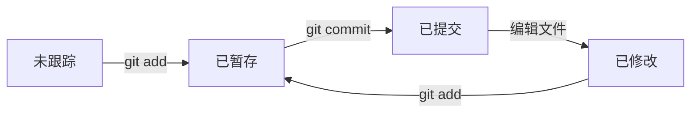

# MDX 组件详细参考

personal-garden 项目中所有可用 MDX 组件的完整参数和用法。

## 1. Callout 提示框

高亮重要信息，支持四种类型。

| type | 用途 | 视觉风格 |
|------|------|---------|
| `info` | 一般信息 | 蓝色 |
| `tip` | 实用技巧 | 绿色 |
| `warning` | 注意事项 | 黄色 |
| `error` | 危险/错误 | 红色 |

**属性：**
- `type`: "info" | "tip" | "warning" | "error"（默认 "info"）
- `title`: 自定义标题（可选）

```mdx
<Callout type="tip">
简短的技巧说明。
</Callout>

<Callout type="warning" title="注意">
自定义标题的警告内容。
</Callout>
```

**适用场景：** 关键概念提示、易错点提醒、最佳实践建议。
**不适用：** 长篇详细说明（用 Collapse）。

---

## 2. Collapse 折叠面板

隐藏详细内容，点击展开查看。

**属性：**
- `title`: 面板标题（必填）
- `defaultOpen`: 是否默认展开（可选，默认 false）

```mdx
<Collapse title="点击查看详细实现">
详细内容...
</Collapse>

<Collapse title="默认展开" defaultOpen>
默认打开的内容...
</Collapse>
```

**适用场景：** 补充说明、详细推导、长代码示例、扩展阅读。
**不适用：** 核心内容（不应隐藏关键信息）。

---

## 3. Tabs 标签页

在多个内容之间切换，适合对比展示。

**属性：**
- `labels`: string[] — 标签名称数组（必填）

**TabItem 属性：**
- `index`: number — 从 0 开始的索引（必填）
- `active`: boolean — 是否默认激活（可选）

```mdx
<Tabs labels={['Python', 'JavaScript', 'Go']}>
<TabItem index={0} active>

```python
print("Hello")
```

</TabItem>
<TabItem index={1}>

```javascript
console.log("Hello");
```

</TabItem>
<TabItem index={2}>

```go
fmt.Println("Hello")
```

</TabItem>
</Tabs>
```

**适用场景：** 多语言代码对比、不同方案对比、同一概念的不同视角。
**不适用：** 非对比性内容（不要用 Tabs 做普通分节）。

---

## 4. Progress 进度条

展示学习进度或完成状态。

**属性：**
- `value`: number — 当前值（必填）
- `max`: number — 最大值（可选，默认 100）
- `label`: string — 标签文字（可选）
- `color`: string — 颜色（可选）

```mdx
<Progress value={75} label="Python 基础" />
<Progress value={100} label="已完成" />
<Progress value={30} max={50} label="30/50 课时" />
```

**适用场景：** 标记各主题学习进度、展示章节完成度。

---

## 5. Image 图片

支持调整大小和对齐方式。

**属性：**
- `src`: string — 图片路径（必填）
- `alt`: string — 替代文字（可选）
- `width`: string — 宽度，如 "200px"（可选）
- `height`: string — 高度（可选）
- `align`: "left" | "center" | "right" — 对齐（可选，默认居中）
- `caption`: string — 标题说明（可选）

**路径支持：**
- 相对路径：`./_media/photo.png`（相对于当前笔记）
- 绝对路径：`/media/images/photo.png`（相对于站点根目录）
- 外部 URL：`https://example.com/photo.png`

```mdx
<!-- 推荐：Markdown 语法，自动居中 -->


<!-- 需要调整大小或对齐时使用组件 -->
<Image src="./_media/photo.png" alt="Logo" width="200px" align="left" caption="图1：Logo" />
```

---

## 6. Media 媒体

视频播放和文档下载。

**属性：**
- `type`: "video" | "document" — 媒体类型（必填）
- `src`: string — 文件路径（必填）
- `width`: string — 宽度（可选，视频默认 "640px"）
- `caption`: string — 标题说明（可选）
- `alt`: string — 替代文字（可选，文档类型）

**支持格式：**
- 视频：`.mp4`, `.webm`
- 音频：`.mp3`, `.wav`
- 文档（点击下载）：`.md`, `.mdx`, `.pdf`, `.docx`, `.txt`

```mdx
<Media type="video" src="./_media/demo.mp4" width="640px" caption="演示" />
<Media type="document" src="./_media/guide.pdf" alt="使用指南" />
```

---

## 7. Table 表格

两种方式创建表格：

### Markdown 表格（推荐）

自动转换为带样式的 HTML 表格：

```mdx
| 列1 | 列2 | 列3 |
|-----|-----|-----|
| 数据 | 数据 | 数据 |
```

### HTML Table 组件

需要自定义对齐或标题时使用：

**属性：**
- `align`: "left" | "center" | "right" — 文字对齐（可选，默认 center）
- `caption`: string — 表格标题（可选）
- `scrollable`: boolean — 移动端可滚动（可选，默认 true）

```mdx
<Table align="left" caption="技术栈对比">
  <thead>
    <tr><th>技术</th><th>用途</th></tr>
  </thead>
  <tbody>
    <tr><td>Astro</td><td>框架</td></tr>
    <tr><td>Tailwind</td><td>CSS</td></tr>
  </tbody>
</Table>
```

---

## 8. Latex 公式

块级公式对齐控制。

**属性：**
- `align`: "left" | "center" | "right" — 对齐（可选，默认 center）

```mdx
<!-- 默认居中 -->
<Latex>
$$
E = mc^2
$$
</Latex>

<!-- 左对齐 -->
<Latex align="left">
$$
\sum_{i=1}^{n} i = \frac{n(n+1)}{2}
$$
</Latex>

<!-- 行内公式 -->
这是行内公式 $a^2 + b^2 = c^2$ 的写法。
```

---

## 9. 知识卡片与 Mermaid

### KnowledgeMap 知识卡片（替代固定画布思维导图）

```mdx
<KnowledgeMap data={{
  name: "Git 五大区域",
  description: "先读摘要；有子项的卡片可点击或按 Enter 展开。",
  children: [
    { name: "工作区 · Working Directory", description: "编辑文件的地方", command: "git status · git diff" },
    { name: "暂存区 · Index / Stage", description: "选择下一次提交的内容", children: [
      { name: "添加修改", command: "git add <file>" },
      { name: "检查暂存", command: "git diff --cached" }
    ] }
  ]
}} />
```

`name` 必填；`description` 是始终可见的摘要；`detail` 是展开后的补充文字；`command` 放短命令；`children` 可递归。文字自动换行，手机自动单列，原生折叠无需脚本。字段内容为纯文本，不解析 Markdown。核心信息放摘要，不能只藏在折叠中。

旧 `<BraceMap data={...} />` 保留为兼容入口，渲染相同卡片；新笔记只使用 `<KnowledgeMap>`。不要再使用 `nodeWidth`、`nodeHeight`、`braceColor` 等固定画布配置。

### Mermaid 可视化（Markdown / MDX 均无需 import）

````md

````

- 流程用 `flowchart`；状态机可用 `stateDiagram-v2`；交互时序可用 `sequenceDiagram`；仅展示分支历史时可用 `gitGraph`。
- 默认居中；宽图在图内横向滚动，提供放大/缩小、适应窗口、Escape 关闭和源码查看。明暗主题随网站切换，不在笔记里写死颜色。
- 纵向流程优先 `TB`，短流程可用 `LR`；超过 6–8 个复杂节点时拆图。节点用稳定英文 ID，中文标签用双引号。
- 给图写 `title="..."` 和 `accTitle:`。避免 init 指令、HTML 标签、click 回调、外部图片和自定义脚本。
- 展示命令执行结果的代码块保持原样。**不得用空格、箭头、ASCII 边框拼流程图/概念树**；目录概览用 KnowledgeMap，矩阵结果用表格；实际终端输出与源代码保留。
- 按原文核对方向、条件、HEAD/分支/标签指针、前后状态，不能仅把旧图的布局机械照搬。图下保留关键解释。
- 图表在浏览器按需渲染；禁用 JavaScript、加载失败或语法错误时，保留可阅读/复制的源码。知识卡片始终可用。

---

## 10. Gallery 画廊

多图网格布局。

**属性：**
- `columns`: number — 列数（可选，默认 3）

```mdx
<Gallery columns={3}>
  
  
  
</Gallery>
```

---

## 11. Wiki 双向链接

关联其他笔记，自动建立反向链接索引。

```mdx
<!-- 基本用法 -->
[[笔记标题]]

<!-- 带说明 -->
- [[虚拟内存]] — Linux 虚拟内存机制
- [[基础语法]] — Python 基础语法
```

**注意：** 链接目标是笔记的 `title`（不含序号前缀），不是文件名。

---

## 组件组合模式

### 概念+细节模式
```mdx
## 概念名称

<Callout type="tip">核心要点</Callout>

概述文字...

<Collapse title="详细实现">
详细内容...
</Collapse>
```

### 多方案对比模式
```mdx
## 方案对比

<Tabs labels={['方案A', '方案B']}>
<TabItem index={0} active>
方案A的内容和代码...
</TabItem>
<TabItem index={1}>
方案B的内容和代码...
</TabItem>
</Tabs>
```

### 知识体系模式
```mdx
## 知识总览

<KnowledgeMap data={{ name: "主题", children: [{ name: "子主题", description: "始终显示的摘要" }] }} />

### 子主题1
详细内容...

### 子主题2
详细内容...
```
