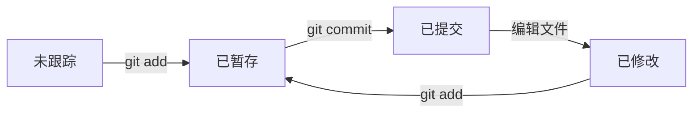
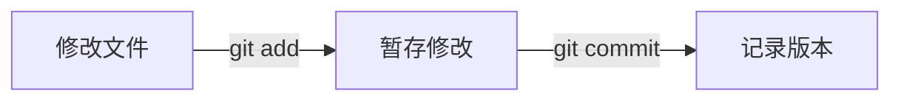

# MDX 组件说明

本文档汇总所有自定义 MDX 组件的使用方法和示例。

---

## 1. 提示框 (Callout)

用于高亮显示重要信息，支持多种类型。

<Callout type="info">
这是一个信息提示框，用于展示一般信息。
</Callout>

<Callout type="tip">
这是一个技巧提示框，用于展示实用技巧。
</Callout>

<Callout type="warning">
这是一个警告提示框，用于提醒注意事项。
</Callout>

**使用方式：**

```mdx
<Callout type="info">
信息内容
</Callout>
```

---

## 2. 折叠面板 (Collapse)

用于隐藏详细内容，点击展开。

<Collapse title="点击展开详细内容">
这是折叠面板的内容。可以用来隐藏详细的说明或代码示例。
</Collapse>

**使用方式：**

```mdx
<Collapse title="标题">
折叠内容
</Collapse>
```

---

## 3. 标签页 (Tabs)

用于在多个内容之间切换。

<Tabs labels={['JavaScript', 'Python', 'TypeScript']}>
<TabItem index={0} active>

```javascript
function hello(name) {
  return `Hello, ${name}!`;
}
```

</TabItem>
<TabItem index={1}>

```python
def hello(name):
    return f"Hello, {name}!"
```

</TabItem>
<TabItem index={2}>

```typescript
function hello(name: string): string {
  return `Hello, ${name}!`;
}
```

</TabItem>
</Tabs>

**使用方式：**

```mdx
<Tabs labels={['标签1', '标签2']}>
<TabItem index={0} active>
内容1
</TabItem>
<TabItem index={1}>
内容2
</TabItem>
</Tabs>
```

---

## 4. 进度条 (Progress)

用于展示进度或完成状态。

<Progress value={100} label="URL掩码" />
<Progress value={100} label="媒体文件" />
<Progress value={100} label="LaTeX对齐" />
<Progress value={100} label="表格样式" />

**使用方式：**

```mdx
<Progress value={80} label="进度名称" />
```

---

## 5. 图片 (Image)

支持调整大小和对齐方式。

**基本用法（Markdown 语法，自动居中）：**


**使用组件调整大小：**

<Image src="./_media/test-icon.svg" alt="小图标" width="100px" />

**左对齐：**

<Image src="./_media/test-icon.svg" alt="左对齐" width="80px" align="left" />

**右对齐：**

<Image src="./_media/test-icon.svg" alt="右对齐" width="80px" align="right" />

**带标题说明：**

<Image src="./_media/test-icon.svg" alt="带标题" width="120px" caption="图1：测试SVG图标" />

**使用方式：**

```mdx
<!-- 推荐：Markdown 语法，自动居中 -->


<!-- 需要调整大小或对齐时使用组件 -->
<Image src="./_media/photo.png" alt="描述" width="200px" align="left" caption="标题" />
```

<Callout type="info">
**路径支持：**
- 相对路径：`./_media/photo.png`（相对于当前笔记目录）
- 绝对路径：`/media/images/photo.png`（相对于站点根目录）
- 外部URL：`https://example.com/photo.png`
</Callout>

---

## 6. 视频与文档 (Media)

支持视频播放和文档下载。

**使用方式：**

```mdx
<!-- 视频 -->
<Media type="video" src="./_media/demo.mp4" width="640px" caption="演示视频" />

<!-- 文档下载 -->
<Media type="document" src="./_media/guide.md" alt="使用指南" />
```

支持的文档类型：`.md`、`.mdx`、`.pdf`、`.docx`、`.txt` 等

---

## 7. 表格 (Table)

支持两种方式创建表格：Markdown 语法和 HTML 语法。

### 7.1 Markdown 表格（推荐）

直接使用 Markdown 表格语法，自动转换为带样式的表格：

| 名称 | 类型 | 描述 |
|------|------|------|
| Astro | 框架 | 静态站点生成器 |
| Tailwind | CSS | 原子化CSS框架 |
| KaTeX | 库 | LaTeX数学公式渲染 |

### 7.2 HTML 表格

使用 HTML 语法可以设置更多属性（对齐、标题等）：

<Table caption="示例表格" align="center">
  <thead>
    <tr>
      <th>属性</th>
      <th>类型</th>
      <th>默认值</th>
    </tr>
  </thead>
  <tbody>
    <tr>
      <td>align</td>
      <td>string</td>
      <td>'center'</td>
    </tr>
    <tr>
      <td>caption</td>
      <td>string</td>
      <td>undefined</td>
    </tr>
  </tbody>
</Table>

**左对齐表格：**

<Table align="left">
  <thead>
    <tr>
      <th>函数</th>
      <th>用途</th>
    </tr>
  </thead>
  <tbody>
    <tr>
      <td>hashSlug</td>
      <td>生成哈希</td>
    </tr>
    <tr>
      <td>registerSlug</td>
      <td>注册并缓存</td>
    </tr>
  </tbody>
</Table>

**使用方式：**

```mdx
<!-- Markdown 语法（推荐，自动转换） -->
| 列1 | 列2 |
|-----|-----|
| 数据 | 数据 |

<!-- HTML 语法（需要设置对齐或标题时） -->
<Table align="left" caption="表格标题">
  <thead>
    <tr><th>列1</th><th>列2</th></tr>
  </thead>
  <tbody>
    <tr><td>数据</td><td>数据</td></tr>
  </tbody>
</Table>
```

<Callout type="tip">
Markdown 表格自动转换为带样式的 HTML 表格。如果需要设置对齐方式或标题，请使用 HTML 语法的 `<Table>` 组件。
</Callout>

---

## 8. LaTeX 公式 (Latex)

支持块级公式的对齐控制。

**居中对齐（默认）：**

<Latex>
$$
E = mc^2
$$
</Latex>

**左对齐：**

<Latex align="left">
$$
\sum_{i=1}^{n} i = \frac{n(n+1)}{2}
$$
</Latex>

**右对齐：**

<Latex align="right">
$$
a^2 + b^2 = c^2
$$
</Latex>

**行内公式：**

行内公式示例：$a^2 + b^2 = c^2$，$\sum_{i=1}^{n} i = \frac{n(n+1)}{2}$

**使用方式：**

```mdx
<!-- 默认居中 -->
<Latex>
$$
E = mc^2
$$
</Latex>

<!-- 左对齐 -->
<Latex align="left">
$$
\sum_{i=1}^{n} i = \frac{n(n+1)}{2}
$$
</Latex>
```

---

## 9. 知识卡片与可视化流程图

概念分类使用知识卡片：长文字自动换行，摘要始终显示，深层内容默认展开，可手动收起，不再受固定画布宽度限制。

<KnowledgeMap data={{
  name: "Git 五大区域",
  description: "一眼查看概念与常用命令；点击暂存区可展开细节。",
  children: [
    { name: "工作区 · Working Directory", description: "编辑项目文件的地方", command: "git status · git diff" },
    { name: "暂存区 · Index / Stage", description: "准备下一次提交的内容", children: [
      { name: "添加修改", command: "git add <file>" },
      { name: "检查内容", command: "git diff --cached" }
    ] },
    { name: "本地版本库 · Local Repository", description: "记录提交历史", command: "git commit · git log" }
  ]
}} />

**复制这个格式即可添加知识卡片，无需 import：**

```mdx
<KnowledgeMap data={{
  name: "主题",
  children: [
    { name: "概念一", description: "始终显示的摘要", command: "常用命令" },
    { name: "概念二", description: "先读这里", detail: "展开后的补充说明", children: [
      { name: "子概念", description: "进一步解释" }
    ] }
  ]
}} />
```

| 字段 | 用途 |
| --- | --- |
| `name` | 标题，必填 |
| `description` | 始终可见的简短摘要 |
| `detail` | 展开后显示的纯文本补充 |
| `command` | 短命令或速查内容 |
| `children` | 可递归的子概念数组 |

字段均为纯文本；代码示例和长段落仍放正文。旧 `BraceMap` 入口保留兼容，固定节点宽度、颜色配置不再生效。

### Mermaid 流程图

Markdown 与 MDX 均可直接写 Mermaid 围栏。默认居中，宽图可横向滚动；支持主题切换、放大预览、缩放和源码查看，按 Escape 关闭预览。



**复制下面的围栏即可：**

````md

````

较长的流程改用 `flowchart TB` 纵向排列，复杂内容拆成多张图。节点用英文 ID，中文标签加双引号，不写死主题颜色。没有 JavaScript 或渲染失败时仍可查看源码。不要再用空格、箭头和字符边框拼流程图。

---

## 10. 代码块 (CodeBlock)

支持代码高亮和复制功能。

```javascript
function fibonacci(n) {
  if (n <= 1) return n;
  return fibonacci(n - 1) + fibonacci(n - 2);
}
```

**使用方式：**

````mdx
```javascript
// 代码内容
```
````

---

## 11. 画廊 (Gallery)

用于展示多张图片的网格布局。

**使用方式：**

```mdx
<Gallery columns={3}>
  
  
  
</Gallery>
```

---

## 12. Wiki 链接

支持双向链接，自动关联相关笔记。

**示例：**

- [[基础语法]] - Python基础语法
- [[虚拟内存]] - Linux虚拟内存机制
- [[CFS 调度器]] - Linux进程调度

**使用方式：**

```mdx
[[笔记标题]]
```

---

## 总结

所有可用组件：

| 组件 | 用途 | 推荐场景 |
|------|------|----------|
| `<Callout>` | 提示框 | 高亮重要信息 |
| `<Collapse>` | 折叠面板 | 隐藏详细内容 |
| `<Tabs>` | 标签页 | 多语言代码对比 |
| `<Progress>` | 进度条 | 展示完成状态 |
| `<Image>` | 图片 | 需要调整大小/对齐时 |
| `<Media>` | 媒体 | 视频播放/文档下载 |
| `<Table>` | 表格 | 需要自定义样式时 |
| `<Latex>` | LaTeX公式 | 块级公式对齐 |
| `<KnowledgeMap>` | 结构图 | 层次关系展示 |
| `<CodeBlock>` | 代码块 | 代码高亮 |
| `<Gallery>` | 画廊 | 图片网格展示 |

## 代码排版与展开状态

代码块、行内代码与知识卡片命令统一使用本地字体：JetBrains Mono 搭配 Noto Sans SC，桌面字号 15px、手机 14px。长代码在代码块内部横向滚动，复制内容保持原始文本。

笔记中的 Collapse 和知识卡片默认展开，可点击标题或按 Enter 收起/展开。Mermaid 图直接显示，源码面板默认收起。
