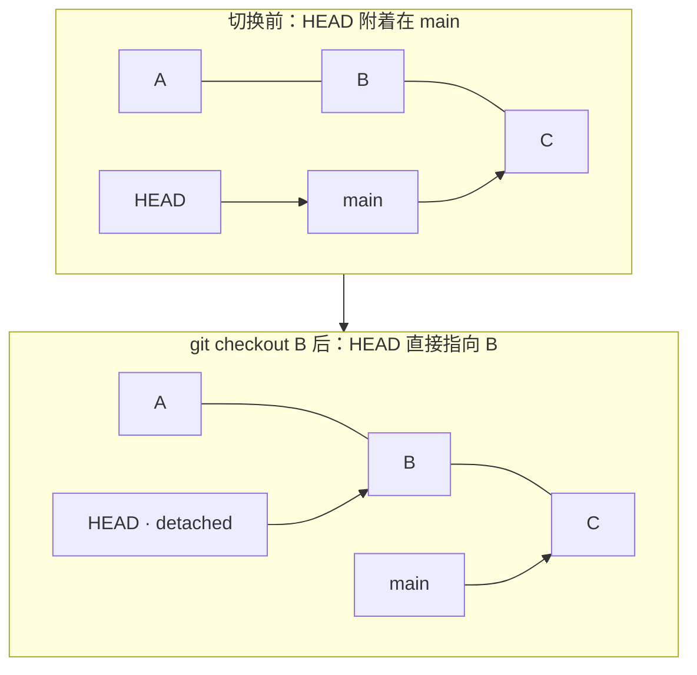
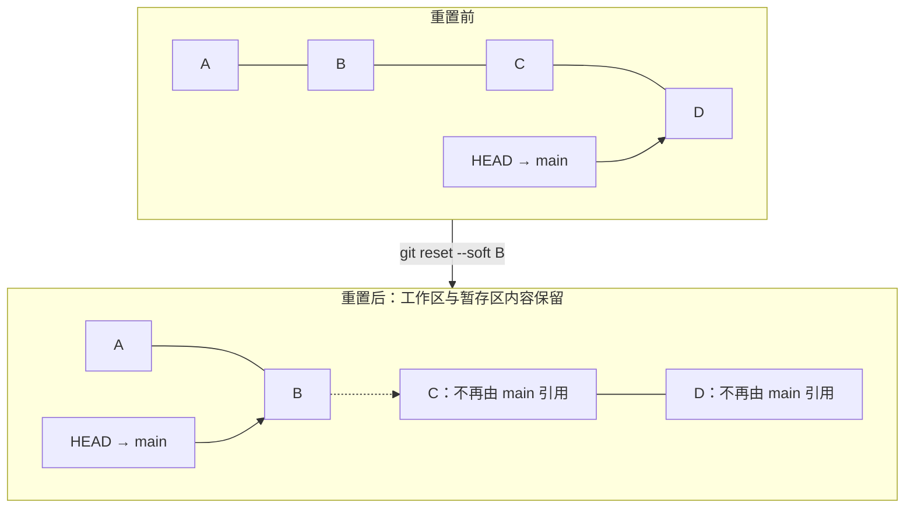
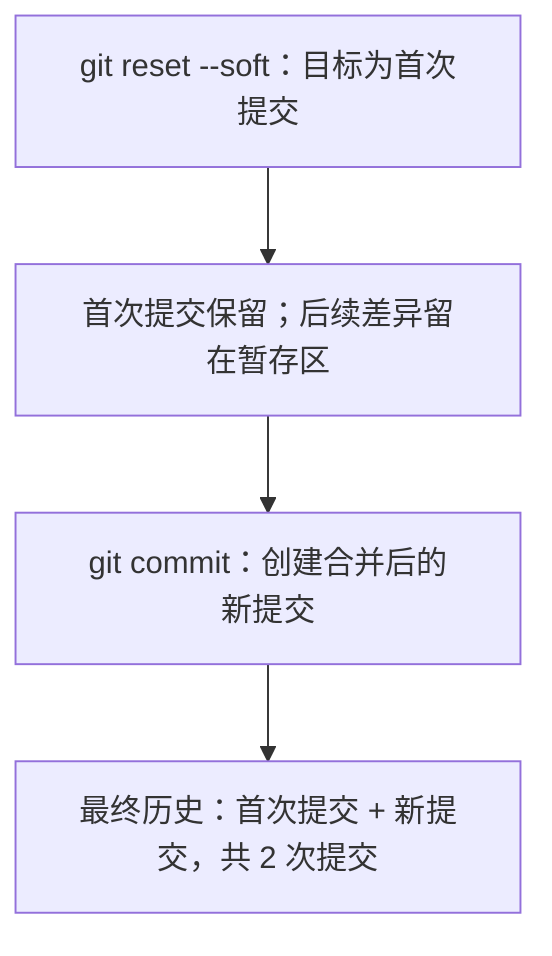
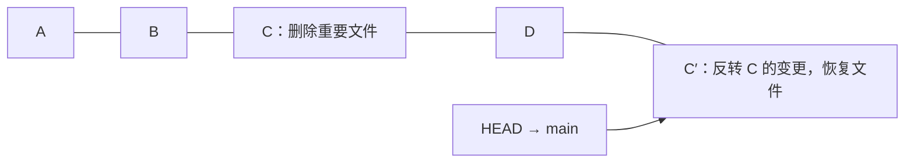
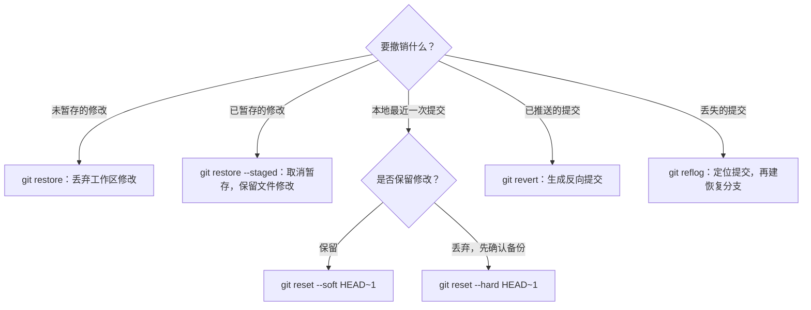

# 撤销与回退

## git checkout

### 恢复文件到某个提交

```powershell
# 恢复工作目录中的某个文件到某个提交的状态
# <commit> 可以是 commit hash、分支名、标签名
# <filename> 是要恢复的文件路径
git checkout <commit> -- <filename>

# 示例：将 file.txt 恢复到提交 abc123 的状态
git checkout abc123 -- file.txt
```

### Detached HEAD（分离头指针）

`git checkout <commit>` 的意思是：将你的工作目录切换到指定的某一次提交的状态。当你 checkout 一个具体的 commit hash（而不是分支名）时，HEAD 不再指向任何分支，而是直接指向那个提交节点。



#### 三种典型用法

```powershell
# ==================== 1. 纯查看（只读模式） ====================
# 切到某个历史提交看看
git checkout a1b2c3d

# 看完之后，回到原来的分支
git checkout main

# ✅ 安全操作，只要你不修改文件，随时可以回来。

# ==================== 2. 基于历史提交创建新分支 ====================
# 从旧提交创建一个新分支，避免 Detached HEAD
git checkout -b hotfix-v1.0 a1b2c3d

# ✅ 最佳实践：如果你打算在历史版本上做任何修改，永远先创建新分支。

# ==================== 3. 在 Detached HEAD 下做了修改 ====================
git checkout a1b2c3d
# ... 改了一些文件并 commit 了 ...
# 此时这些提交不属于任何分支！

# 补救方法：赶紧创建分支保存它们
git checkout -b rescue-branch

# ⚠️ 如果直接在 Detached HEAD 下 commit 后又切回 main，
# 那些提交会变成孤儿，可能被 GC 回收丢失！
```

<Callout type="warning">
**Detached HEAD 注意事项**

- 在 Detached HEAD 状态下，你仍然可以查看文件、运行命令
- 如果做了修改并 commit，这些提交没有分支归属
- 一旦切回其他分支，这些孤儿提交可能被 Git 垃圾回收机制删除
- **最佳实践**：始终在正式分支上工作
</Callout>

## git reset

重置当前分支到特定提交。有三种模式，区别在于对工作区和暂存区的处理方式。

```powershell
# ==================== 三种重置模式 ====================

# --soft：保留工作区和暂存区的修改，只重置 HEAD 指针
# 最温和的重置，适合撤销 commit 但保留修改
git reset --soft <commit>

# --mixed：保留工作区的修改，重置暂存区和 HEAD 指针（默认选项）
# 中等力度，适合重新组织提交
git reset --mixed <commit>

# --hard：丢弃工作区和暂存区的修改
# 最危险的重置，会丢失所有未提交的修改
git reset --hard <commit>
```

### 三种模式对比

| 模式 | HEAD 指针 | 暂存区 | 工作区 | 使用场景 |
|------|-----------|--------|--------|----------|
| `--soft` | ✅ 重置 | ❌ 保留 | ❌ 保留 | 撤销 commit，保留所有修改 |
| `--mixed` | ✅ 重置 | ✅ 重置 | ❌ 保留 | 撤销 commit 和 add，保留修改 |
| `--hard` | ✅ 重置 | ✅ 重置 | ✅ 重置 | 彻底回退，丢弃所有修改 |

### 重置示意图



C、D 不再从 main 可达，但通常仍能通过 reflog 找回；它们不会立即从对象数据库消失。

<Callout type="error">
**⚠️ git reset --hard 危险警告**

`--hard` 是最危险的选项，它会直接抹掉工作区的修改。使用前请确保：

1. 所有重要修改已经提交
2. 已创建备份分支
3. 确实想要丢弃这些更改
</Callout>

### 实际应用场景

#### 场景一：让远程仓库退回某个提交并彻底删除后续提交

```powershell
# 第一步：创建安全备份
git branch backup-before-reset D       # 备份当前 HEAD（D）到一个新分支
git push origin backup-before-reset    # 推送备份分支到远程仓库

# 第二步：重置本地分支到 B
git checkout main                      # 确保在正确的分支上
git reset --hard B                     # 重置本地分支到 B

# 第三步：推送到远程
# 普通的 git push 会被拒绝，因为本地落后于远程
# 命令一：（推荐）安全强制推送
# 只有当远程分支仍在你上次 fetch 的状态时才允许推送
git push --force-with-lease origin main

# 命令二：强制推送（不推荐，可能覆盖别人的提交）
git push --force origin main

# 验证结果
git log origin/main                    # 应该只看到 A --- B
```

#### 场景二：将多个 commit 合并成一个提交

```powershell
# 先克隆仓库（如果还没有的话），保证工作区和暂存区是最新的

# 1. 查看历史，找到目标 commit
git log --oneline

# 2. 重置到那个 commit（保留更改在暂存区）
git reset --soft <目标commit-hash>

# 3. 重新提交（将所有更改合并为一个提交）
git commit -m "合并后的提交"

# 4. 强制推送
git push --force
```

#### ⚠️ 场景二补充：为什么云端显示 2 次提交？

如果你将 `<目标commit-hash>` 填写为**第一次提交的 hash 值**，操作完成后云端会显示 **2 次提交**。



`git reset --soft <hash>` 的机制是将当前分支指针移动到指定的 `<hash>` 上，同时保留该 commit 之后的所有更改在暂存区。因此**第一次提交本身被保留**，而你执行 `git commit` 时又**创建了一个全新的 commit**，所以最终是 2 个。

#### ✅ 如何让云端只显示 1 次提交

若目标是让仓库历史彻底压缩为单一 commit，你需要重置到第一次提交的**父级**（即一个不存在的空状态）：

```powershell
# 创建无历史的新分支（最稳妥的方式）
git checkout --orphan temp-single-commit

# 暂存所有文件并提交
git add -A
git commit -m "合并后的提交"

# 替换原分支并强推
git branch -M main
git push --force-with-lease origin main
```

> **关键区别总结**

| 操作 | 目标 Hash | 结果 Commit 数 | 说明 |
| :--- | :--- | :--- | :--- |
| `reset --soft <首次commit>` | 首次提交本身 | **2** | 保留了首次提交 + 新建的合并提交 |
| `checkout --orphan` | 无历史起点 | **1** | 完全脱离旧历史，最干净 |

操作完成后可通过以下命令确认实际 commit 数量：

```powershell
git log --oneline   # 本地验证
```

若你的初衷确实是保留第一次提交作为"项目起点"、后续所有迭代压缩为第二个 commit，那么原始操作（填首次 commit hash）就是正确的，无需修改。

## git revert

撤销某次提交，但保留历史记录。与 `git reset` 不同，`revert` 会创建一个新的反向提交。

```powershell
# 创建一个新的提交，撤销指定的提交
# <commit> 是要撤销的提交的哈希值
git revert <commit>
```

### revert vs reset 对比

| 特性 | `git revert` | `git reset` |
|------|--------------|-------------|
| 操作逻辑 | 新增一个反向提交（Forward） | 回退分支指针（Backward） |
| 历史记录 | 完整保留，可追溯 | 被改写/截断 |
| 已推送的提交 | 安全，不影响他人 | 危险，会导致协作灾难 |
| 适用场景 | 公共分支、已推送的错误修复 | 本地未推送的整理、私密分支 |
| 类比 | 财务上的「红字冲销」 | 撕掉账本重写 |

### revert 示意图



<Callout type="tip">
**选择 revert 还是 reset？**

- **已推送到远程的提交**：使用 `git revert`，因为它不会改变历史，对其他协作者安全
- **本地未推送的提交**：可以使用 `git reset`，因为它更干净，不会产生额外的提交
</Callout>

## git reflog

`git reflog` 记录了所有 HEAD 的移动。即使提交被删除或重置，也可以通过 reflog 找回。

```powershell
# 查看 HEAD 的历史操作记录
# 包括 commit、reset、checkout、merge 等操作
git reflog

# 回到三次操作前的状态
# HEAD@{n} 是"HEAD 的移动日记"，n 是操作序号
git reset --hard HEAD@{3}
```

### reflog 输出示例

```text
$ git reflog

a1b2c3d HEAD@{0}: commit: 添加新功能
b2c3d4e HEAD@{1}: reset: moving to HEAD~1
c3d4e5f HEAD@{2}: commit: 修复 bug
d4e5f6g HEAD@{3}: checkout: moving from main to feature
e5f6g7h HEAD@{4}: commit: 初始提交
```

<Callout type="info">
**reflog 的作用**

- **后悔药**：误操作后可以找回丢失的提交
- **时间机器**：可以回到任何历史状态
- **调试工具**：查看操作历史，了解发生了什么

**注意**：reflog 只记录本地操作，且有时间限制（默认 90 天）。
</Callout>

## 操作选择指南



上述 `git restore` 用法分别对应前文的 `git checkout -- <file>` 和 `git reset HEAD <file>`。恢复丢失提交时可先执行 `git branch recovered <hash>`，确认内容后再决定是否重置当前分支。

---

**相关笔记**：
- [[查看历史]] — 查看提交历史
- [[远程仓库操作]] — 远程仓库的推送和拉取